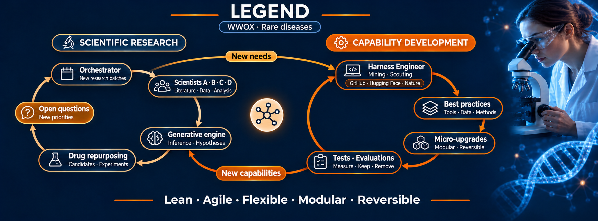

# LEGEND — From Evidence to Therapeutic Discovery

## ⚠️ Disclaimer: AI-curated, and not medical advice

**LEGEND uses AI to curate and maintain research material.** It connects scientific literature, public data and computational analyses. Source checks and automated tests help readers trace the evidence. Scientific interpretations can still be incomplete or wrong.

**Use LEGEND for research and discussion with qualified clinicians.** Its findings and research priorities do not establish treatment benefit or safety. Clinical decisions belong to the treating team.



**An open-source, AI-assisted research platform connecting scientific evidence, mechanistic inference, computational experiments and drug repurposing for rare diseases.**

LEGEND turns fragmented knowledge into testable hypotheses, candidate interventions and research priorities. Its first disease model covers **WWOX-related disorders**, particularly **WOREE / WWOX developmental and epileptic encephalopathy**.

**Website and research dashboard:**

[https://marinomassimo-dot.github.io/legend-development/](https://marinomassimo-dot.github.io/legend-development/)

The English dashboard brings together pathway maps, evidence, open questions and printable research briefs for clinicians and families.

## Drug repurposing

LEGEND explores how existing medicines, OTC products, supplements, dietary approaches and other interventions could address disease-specific biological needs.

The public dashboard focuses on possible **bridge interventions** while the separate WWOX gene therapy programme advances toward a clinical trial. The [WWOX Foundation research page](https://www.wwox.org/current-research/) provides updates on gene therapy.

The module:

- **Connects biology to interventions:** links mechanisms, targets, cell states and phenotypes to potentially relevant compound actions.
- **Generates hypotheses:** combines WWOX evidence with external knowledge and computational methods to explore therapeutic directions.
- **Compares candidates:** considers action, biological context, supporting evidence, counterevidence and missing premises.
- **Prioritizes investigations:** identifies which questions and experiments could most usefully distinguish promising candidates.
- **Revises conclusions:** updates hypotheses and priorities as evidence, databases and methods evolve.

The central question is:

> **Which intervention could help, through what mechanism, in which context—and what experiment would establish whether that hypothesis holds?**

The dashboard makes research priorities, evidence chains and unresolved questions accessible to researchers, clinicians and disease communities.

## How LEGEND works

**Evidence → Mechanisms → Hypotheses → Computational tests → Research priorities → Experimental validation**

LEGEND combines full-text analysis, public biological databases, context-specific reasoning and reproducible computational work. New findings feed back into the model, revising conclusions and reopening earlier questions.

Observations, inferences and predictions remain distinct. Evidence retains its variant, species, tissue, assay and developmental context.

## Current status

LEGEND is under active development. The repository includes a WWOX research model, analysis tools, evidence-linked hypotheses and a public drug-repurposing dashboard.

Generative and predictive capabilities are being evaluated and improved. **Rankings express research priority; therapeutic benefit requires experimental validation.**

See [capabilities and maturity](SKILLS.md), the [drug-repurposing roadmap](disease-models/wwox/research/drug_repurposing/roadmap_current.md) and [architecture](ARCHITECTURE.md).

## Explore and contribute

- **Explore:** [Dashboard](https://marinomassimo-dot.github.io/legend-development/) · [WWOX disease model](disease-models/wwox/disease_model.md) · [Mission and objectives](disease-models/wwox/mission.md)
- **Get started:** [FAQ](FAQ.md) · [Operator manual](framework/manuals/operator_manual.md)
- **Build on LEGEND:** [Contributing](CONTRIBUTING.md) · [Adapt to another disease](framework/ADOPTING.md)

## Quick start after cloning

With Python 3.12, run from the repository root:

```bash
python3 -m venv .venv
source .venv/bin/activate
python3 -m pip install --requirement requirements-analysis.txt
python3 framework/scripts/legend_lint.py .
python3 scripts/test_link_targets.py
python3 scripts/run_release_regressions.py
```

These checks run without an agent. For research workflows, follow the [operator manual](framework/manuals/operator_manual.md). For wiki navigation, open the cloned repository folder directly as an Obsidian vault.

## Support, openness and responsible use

Developed in partnership with, and sponsored by, the **[WWOX Foundation](https://www.wwox.org/current-research/)**. See the [sponsorship statement](SPONSORSHIP.md).

The code is **open source under the [MIT License](LICENSE)**. External data, models, Foundation materials and third-party content retain their respective terms: [Data sources](DATA_SOURCES.md) · [Third-party notices](THIRD_PARTY_NOTICES.md).

This public repository contains disease-level research, not individual patient records. Outputs support scientific investigation and discussion with qualified clinicians; they are not medical advice.
